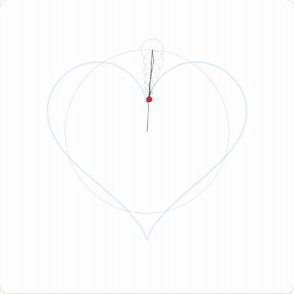

# Lilavati

**Maths you can touch.** Small interactive pages where you draw, drag and play with one big idea at a time,
then scroll down and it explains itself step by step, with fun facts along the way.

<p align="center"></p>
<p align="center"><em>Circles riding on circles, drawing a heart. That's a Fourier series.</em></p>

**Try it:** https://lilavati.pages.dev, in any browser, on a phone too. Nothing to install.

## Why “Lilavati”

In 1150 the Indian mathematician Bhāskara II wrote a book of arithmetic and geometry called *Līlāvatī*,
“the playful one”. Instead of dry rules it is full of puzzles about bees, peacocks, monkeys and bamboo,
often addressed to a girl: *“O lovely one with eyes like a fawn, tell me…”*

A story first written down centuries later, in the Persian translation made for Emperor Akbar's court in
1587, says Līlāvatī was Bhāskara's daughter. The stars allowed her only one lucky moment to marry, so he
floated a cup with a tiny hole in a bowl of water, a water clock that would sink at the chosen hour. A
pearl slipped from her bridal dress into the cup and blocked the hole; the cup never sank, the moment
passed, and the marriage never brought her happiness. To comfort her, Bhāskara wrote a book in her name,
promising it would be remembered for ever.

Historians treat the story as a legend, but the book is real and taught mathematics in India for
centuries. This project borrows its idea: **maths as play**.

> *One of her puzzles:* the square root of half a swarm of bees flew to a jasmine bush; eight-ninths of
> the swarm stayed behind; one bee hummed around a lotus where another was trapped. How many bees?
> *(Answer: 72.)*

## What's inside

Each page takes one idea, from Fourier series and orbits to the matrix maths behind AI, and starts from
something you've seen in real life. Every page has a picture to play with, small experiments to try, a
step-by-step walk-through drawn from whatever you set up, the formulas read out in plain words, fun facts
and further reading. New pages are added regularly: see them all at **https://lilavati.pages.dev**.

## How it's built

- **The maths is in Rust** (`src/`), compiled to WebAssembly and run in your browser, and checked by
  `cargo test` against known answers.
- **The pages are plain HTML and JavaScript** (`web/`) with [Pico CSS](https://picocss.com). No framework,
  no build step for the pages themselves.
- **Hosted on Cloudflare Pages.**

| Where | What |
|---|---|
| `src/` | The maths, one Rust module per topic, with tests |
| `web/<concept>/` | One folder per concept page |
| `web/concepts.js` | The list of concepts and chapters; builds the home page and page navigation |
| `web/la.js` | Shared drawing for the linear algebra pages |
| [AGENTS.md](AGENTS.md), [docs/CONCEPT_PAGE.md](docs/CONCEPT_PAGE.md) | How to write a new page |

## Run it

```sh
cargo install wasm-pack            # once
rustup target add wasm32-unknown-unknown
./build.sh                         # tests the maths, builds web/pkg and the site in dist/site
python3 -m http.server 8080 -d dist/site
```

## Add a concept

See [AGENTS.md](AGENTS.md) and [docs/CONCEPT_PAGE.md](docs/CONCEPT_PAGE.md#adding-a-concept).

## License

MIT, see [LICENSE](LICENSE).
